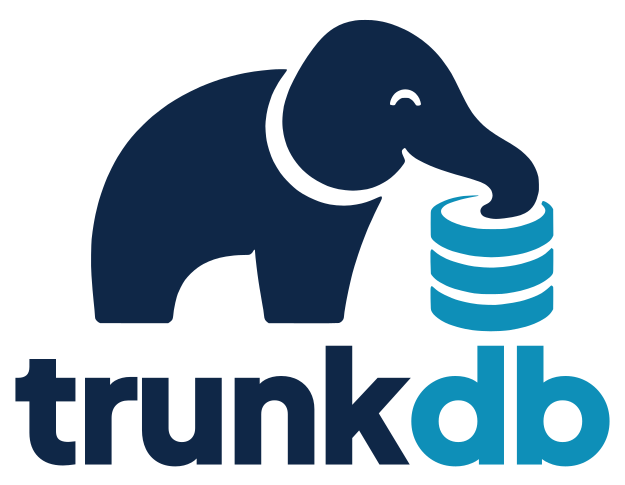

<h1>
  <picture>
    <source media="(prefers-color-scheme: dark)" srcset="assets/trunkdb-logo-dark.svg">
    
  </picture>
</h1>

[](https://github.com/u-schmidt/trunkdb/actions/workflows/ci.yml)

An embedded, single-file, schema-less document database in Rust. Open a
file, get collections of documents: no server, no tables, no joins, no
schema migrations. Any `T: Serialize + Deserialize` is a document.

It started as a way to get [LiteDB](https://www.litedb.org/)'s easy
embedded document store outside .NET, and to learn how a database is
built, from the page layer up. It has grown well past that start,
and it still grows the same way: each step is a
numbered [spec](spec/README.md) section with its reasons and its
measurements.

## Features

- Typed documents through serde, or untyped ones (`Document`).
- Filters in code or as text, with sort, skip and limit, and conditions
  of your own as closures; projection and
  aggregates by group, with a condition per column. Arrays, objects and binary compare by their
  contents with `=` and `!=`.
- Secondary indexes: unique, compound, on nested paths and array
  elements, and sparse; a hint in the query names the one to read.
- Atomic batches across collections; every commit crash-safe through a
  write-ahead log, and reported to subscribers once it is; live
  queries that report what comes to match a filter and what leaves it,
  and live aggregates over a window of the last minutes.
- Readers in parallel beside one writer, and snapshots for reads that
  must agree.
- `explain_run` and `stats` to see how a query ran, what the plans it
  passed over would have read, and where the space goes; `check`,
  `compact`, export and import; a `trunkdb` command line.

## When to use it, and when not

trunkdb fits where SQLite would, but the data is documents rather than
rows: desktop and command-line apps, local caches, tools, small
services, test data. One file, no setup, nothing to run beside it.

It isn't the right choice (yet) for:

- Several processes on one file, or several writers at once.
- Encryption or schema validation in the database.
- Joins, or a cost-based planner: the planner follows fixed rules, and
  `explain` says which one it took.
- A file format fixed for good: a new version may need an export and
  import to move a file up ([ROADMAP.md](ROADMAP.md)).

## Getting started

trunkdb isn't on crates.io yet. Add it from git:

```toml
[dependencies]
trunkdb = { git = "https://github.com/u-schmidt/trunkdb" }
serde = { version = "1", features = ["derive"] }
```

Pinning a commit with `rev = "…"` keeps updates in your hands;
[CHANGELOG.md](CHANGELOG.md) lists what each release changes.

```rust
use serde::{Deserialize, Serialize};
use trunkdb::{Database, DocId, query::Filter};

#[derive(Serialize, Deserialize)]
struct User {
    #[serde(rename = "_id")]
    id: Option<DocId>, // None on insert: one is made; filled in on every read
    name: String,
    team: String,
    age: i64,
}

let db = Database::open("app.trunkdb")?;
let users = db.collection::<User>("users");
users.ensure_index(["team", "age"])?; // once at startup; a no-op after

let id = users.insert(User { id: None, name: "Ada".into(), team: "core".into(), age: 36 })?;
let ada = users.get(&id)?;

let youngest = users.find(Filter::new().eq("team", "core").sort_asc("age").limit(5))?;
let same: Filter = r#"team = "core" order by age limit 5"#.parse()?;
```

[GUIDE.md](GUIDE.md) goes on from here: indexes, updates, batches,
snapshots, selecting fields and aggregates.

## Command line

```
cargo install --git https://github.com/u-schmidt/trunkdb
trunkdb info app.trunkdb                 # format, releases, pages and sizes, collections, indexes
trunkdb check app.trunkdb                # consistency check; exit code 1 on problems
trunkdb compact app.trunkdb              # rebuild into as few pages as needed
trunkdb export app.trunkdb backup.jsonl  # JSON Lines, or to standard output
trunkdb import copy.trunkdb backup.jsonl # `-` reads standard input
trunkdb find app.trunkdb users 'age >= 30 order by name limit 10'
                                         # one JSON document per line
trunkdb find app.trunkdb users 'age >= 30' --explain
                                         # the plan, index reads, counts
trunkdb fields app.trunkdb users         # every path, in how many documents,
                                         # as which types
```

`info`, `check`, `export`, `find` and `fields` open the file read-only.

### For an AI agent

[skills/trunkdb/](skills/trunkdb/SKILL.md) is an
[Agent Skill](https://agentskills.io) that teaches an AI agent with a
shell (Claude Code, Codex, Gemini CLI and others) to look into a
trunkdb file with this command: shape first, then narrow queries, and
never the whole file into its context. Copy the folder to where your
agent reads skills.

## Performance

`bench/` runs one document workload against trunkdb, SQLite, redb and
sled, with the same indexes, durable commits everywhere and the same
answers checked across all four. 100,000 documents on an M1 Pro, the
median of three runs (0.23.0 with §123):

| | trunkdb | SQLite | redb | sled |
|---|---:|---:|---:|---:|
| get by id | 2.8 µs | 6.1 µs | 2.0 µs | 2.6 µs |
| 1000 documents by index | 0.96 ms | 1.7 ms | 1.0 ms | 1.7 ms |
| count of 1000 by index | 0.01 ms | 0.02 ms | 0.03 ms | 0.26 ms |
| page 50 of 20 of a status | 25 µs | 53 µs | 40 µs | 253 µs |
| scan, 100,000 for a fifth | 61 ms | 43 ms | 50 ms | 68 ms |
| insert, 1000 per commit | 32k/s | 44k/s | 45k/s | 30k/s |
| update, 1000 per commit | 13k/s | 16k/s | 19k/s | 24k/s |
| delete, 1000 per commit | 26k/s | 20k/s | 20k/s | 37k/s |
| compact | 1.2 s | 0.16 s | 0.42 s | — |

Reads through an index are level with the others or ahead; a full scan,
inserts and compaction are still behind. The full table, why each number
is what it is, and what each step changed are in
[DESIGN.md](DESIGN.md#12-performance).

## Documentation

- [GUIDE.md](GUIDE.md): how to use it, by example.
- [DESIGN.md](DESIGN.md): how it works today, one subsystem at a time.
- [spec/](spec/README.md): why, one numbered section per step (SPEC §N).
- [CHANGELOG.md](CHANGELOG.md): every step so far, by release.
- [ROADMAP.md](ROADMAP.md): what's left to settle the API and format, and what's open.

## Building

```
cargo build
cargo test
cargo doc --open
```

The minimum Rust version is 1.89, and CI builds with it. It rises
only when a dependency or a real need requires it, never for syntax
alone; a rise is noted in the changelog and isn't counted as breaking.

The current version is 0.26; 0.x versions may still change the API and
the file format, and each release says what breaks and how to move up.

## License

Licensed under the [MIT License](LICENSE).
